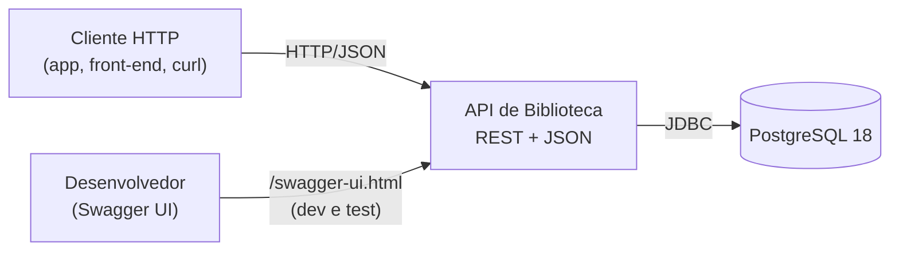
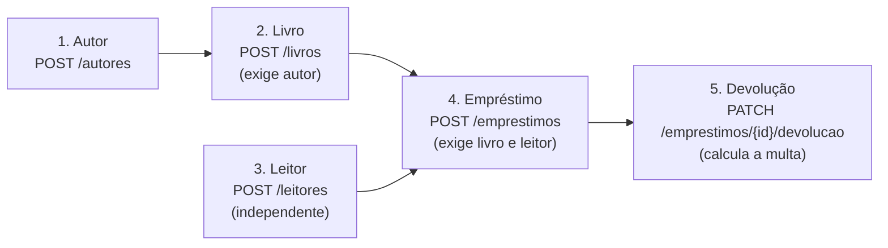

# API de Biblioteca: desenho arquitetural (HLD)

Visão de alto nível do sistema: com quem a API se comunica e em que ordem os recursos são usados.
Os detalhes de stack, arquitetura, configuração e tutorial estão em
[DEPLOY_PLANNING.md](DEPLOY_PLANNING.md).

## 1. Contexto

Quem interage com o sistema e com o que ele se comunica.

- **Um único sistema externo:** o banco PostgreSQL. A API não chama outros serviços, não envia
  e-mail e não usa fila.
- **Sem autenticação nesta versão:** é um risco conhecido e registrado no planejamento de deploy.

## 2. Ordem de uso (por onde começar)

Toda requisição começa no **cliente HTTP**. Para usar o sistema do zero, os recursos precisam ser
criados nesta ordem, porque cada etapa depende de dados das anteriores. Aqui as setas significam
"vem antes de".

| Etapa | Depende de | Se faltar |
|---|---|---|
| 1. Autor | nada (é o ponto de partida do cadastro) | — |
| 2. Livro | um ou mais autores existentes | 404 autor não encontrado |
| 3. Leitor | nada (pode ser criado a qualquer momento antes do empréstimo) | — |
| 4. Empréstimo | um livro com exemplar disponível e um leitor | 404 se não existirem, 409 se não houver exemplar |
| 5. Devolução | um empréstimo | 404 se não existir; repetir devolve o resultado original |

O **fluxo de negócio principal**, a razão de o sistema existir, é o das etapas 4 e 5. As etapas 1
a 3 são cadastros que o preparam. É a mesma sequência dos comandos `curl` do tutorial em
[DEPLOY_PLANNING.md](DEPLOY_PLANNING.md#testando-o-fluxo-completo).
